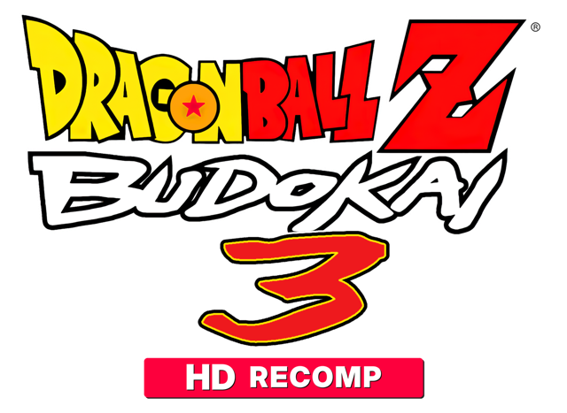
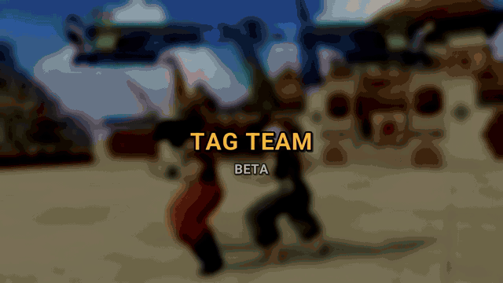

<p align="center"><a href="README.md">Español</a> · <b>English</b></p>

<p align="center">
  
</p>

<h1 align="center">DBZ Budokai 3 HD Collection</h1>

<p align="center">
  <b>Dragon Ball Z: Budokai 3 HD Collection, from Xbox 360 to PC.</b><br>
  A native port for Windows and Linux, not an emulator.
</p>

<p align="center">
  <a href="https://github.com/novapowers0/DBZ-Budokai-3-HD-Collection/releases/latest"></a>
  <a href="https://github.com/novapowers0/DBZ-Budokai-3-HD-Collection/releases"></a>
  
  <a href="LICENSE"></a>
</p>

<p align="center">
  <a href="https://github.com/novapowers0/DBZ-Budokai-3-HD-Collection/releases/latest">
    
  </a>
</p>

<p align="center">
  <b>1.4.4 EX trailer (watch on the release page):</b>
  <a href="https://github.com/novapowers0/DBZ-Budokai-3-HD-Collection/releases/latest">English / español</a>
</p>

<p align="center">
  <a href="../../releases/latest"><b>Download the latest version</b></a> ·
  <a href="CHANGELOG.md">Full changelog</a> ·
  <a href="#install-in-3-steps">Install</a> ·
  <a href="#mods-and-new-characters">Mods</a> ·
  <a href="#common-problems">Problems</a>
</p>

| | |
|---|---|
| Players | 1–2 (versus) |
| Platform | Windows / Linux |
| Engine | Xbox 360 (ReXGlue SDK) |
| Genre | 3D fighting |
| Version | **v1.4.4.4** (1.4.4 EX MAX) |

---

## What's new

### 1.4.4 EX MAX (v1.4.4.4)

- **Tag Team (beta):** picking a mode in TAG TEAM goes **straight to character select** with a fade like the game's own. Fixed: A on TAG TEAM could open the Tournament or the Shop. Leaving character select returns to TAG TEAM.
- **Tag switches (beta):** each fighter comes back in the transformation they left with.
- **Transformation selector (beta):** can be turned off in the launcher. On by default.
- **"Game not found":** the message lets you pick the disc image right there.

<details>
<summary><b>1.4.4 EX++ (v1.4.4.3)</b></summary>

- **Transformation selector (beta):** at character select, LT/RT picks the form you start in. You need that form's capsule equipped.
- **Tag Team (beta):** KO flash when a fighter falls, a more reliable KO, and the swap waits for a transformation to finish.
- **Disc images:** detected even with an uppercase or renamed extension, and the "game not found" message explains what to do.
- **Freezer story (Nova's Mods) 1.1:** new Mecha Freezer portrait.

</details>

<details>
<summary><b>1.4.4 EX+ (v1.4.4.2) and 1.4.4 EX (v1.4.4.1)</b></summary>

**1.4.4 EX+ (v1.4.4.2)**

- **Budokai 2 in the importer:** moves, combos, hair and face (base and Super Saiyan).
- **Tag Team (beta):** no swaps after the fight ends or before "FIGHT!", no fighters left floating when a load fails, and two fewer crashes with techniques on screen.
- **Online (beta):** no more freeze when the opponent leaves, and matches don't start with different mods.
- **Nova's Mods:** if an install fails, the mod you had is kept.

**1.4.4 EX (v1.4.4.1)**

- **Nova's Mods is live:** tab next to **Mods**. One click installs the Freezer story and the 7 pack characters. The previous version of a mod is kept in `mods_respaldo`.
- **Tag Team (beta):** fast swaps could crash the game. The swap now waits for the outgoing fighter's effects to end.

</details>

<details>
<summary><b>1.4.3 EX and 1.4.3</b></summary>

**1.4.3 EX**

- **Performance:** fixed 30 FPS and stutter on powerful PCs, steadier frame pacing and a much lighter launcher.
- **Any GPU:** laptops use the dedicated GPU, fixed the crash on AMD RX 6000/7000/9000, faster Intel Arc and automatic switch to Vulkan if Direct3D 12 fails.
- **Stable with heavy apps open** (browser, recording, antivirus).
- **More reliable HD texture packs** and text translated into French, German and Italian.

**1.4.3**

- **Ultimates for everyone (WIP):** Zarbon, Dodoria and Android 19 get their Budokai 1 ultimate adapted to Budokai 3; Android 19 gets its Budokai 1 moves. This is a first version: expect bugs.
- **Edit Skills fixed:** with new characters installed, the capsule tray was shifted and did not respond.
- **Full Infinite World:** imported characters bring their original moves, techniques and ultimate, and all of them enter hyper mode.
- **USA and European copies** of Budokai 1, Budokai 2, Infinite World and Shin Budokai for the importer.
- **Easier launcher and Kit:** confirmations before deleting or replacing, PLAY without freezing, plain-language errors, full English and an *Ultimate* card in the Kit.

</details>

<details>
<summary><b>1.4.2 EX, 1.4.1 and 1.4.0</b></summary>

**1.4.2 EX**

- **Easy PNG textures:** capture textures while playing, edit the PNG and it applies automatically.
- **Drag-and-drop mods:** drop a `.zip` on the launcher to install it.
- **Broken-mod warning:** the launcher explains what is wrong with each mod and warns next to PLAY.
- **Modding Kit with Python included:** nothing to install.
- **Native mods translated** to the launcher language.
- **Shin Budokai characters:** voices, Burning Attack and ki blasts fixed.
- 1.4.2 brought **NVIDIA DLSS and AMD FSR 3 (beta)**, adjustable HD shine and the Shin Budokai importer.

**1.4.1**

- **Fixes for the 30 FPS lock-up on powerful PCs** (issue #8): precise timing, and Windows no longer puts the game in power-saving mode (efficiency cores).
- GPU crash diagnostics (DRED) no longer cost performance: they only turn on for the session after a GPU crash.
- The log shows where the time goes (`gpu_wait`, `cp_wait`) and records hitches longer than 50 ms.
- The launcher warns when your game is the European version and you have new characters (they only work with the US/NA version).
- Fixed the crash when changing costume on a new character (Janemba) and the music going silent with the characters mod plus a music pack.
- Modding Kit 1.4.1: a **Diagnostics** page that reads the game log and explains what is wrong and what to do.

The character pack is still `DBZ3HD-1.4.0-Personajes.zip` (it works as-is).

**1.4.0**

- **In-game quick menu:** press **F1** or **Back + Start** on the controller and change picture, sound or display settings without leaving the fight. Changes apply instantly and are saved automatically.
- **More FPS with FSR:** the game can render below your resolution and let FSR upscale it.
- **New FPS counter (F3):** game FPS and display FPS, with a frame-time graph.
- **Redesigned launcher:** new look, opens in **under a second** (it used to take ~30 s) and can be driven entirely **with a controller**.
- **New characters** in their own select-screen cells, replacing nobody: Janemba, Android 19, Zarbon, Dodoria, Guldo, Jeice and Burter (optional pack).
- **Character importer** from Budokai 1, Budokai 2, Infinite World and community models, all from the launcher.

</details>

Full list in the [CHANGELOG](CHANGELOG.md).

---

## Screenshots

<!--
TODO(screenshots v1.4.0): save the screenshots as .jpg in docs/screenshots/ (.png is
in .gitignore and publish_check flags it as FAIL), then remove this comment.


-->

*Coming soon.*

---

## Features

### Graphics and performance
- **FSR 1 / CAS** scaling, FXAA and dither. Internal resolution, MSAA and anisotropic filtering, with **live changes** and no restart.
- **More FPS with FSR** (Quality, Balanced, Performance, Ultra performance).
- **NVIDIA DLSS and AMD FSR 3** (beta).
- **FPS panel (F3)**, VRR, a real frame cap and per-GPU quality presets.
- **Texture enhancement** at runtime (experimental) and HD texture packs.

### Mods and modding Kit
- **Mods** that replace game entries without touching the original files. Drop a `.zip` on the launcher to install it.
- **Importer** for characters from Budokai 1, Budokai 2, Infinite World and community models.
- Own **capsules, yells and voices**, **extra costumes** for existing characters, and **model swap** B3↔B3 (183-character catalog).
- **Modding Kit** with Python included, to create and import characters.

### Nova's Mods (new in 1.4.4)
- Tab next to **Mods**: one click installs the Freezer story and the 7 pack characters.
- Updates come from there. The previous version of a mod is kept in `mods_respaldo`.

### New characters
- **7 characters** in their own select-screen cells (they replace nobody): Janemba, Android 19, Zarbon (with his transformation), Dodoria, Guldo, Jeice and Burter.
- Models by **@ArielPVB** for Guldo, Jeice, Burter, Zarbon, Dodoria and Android 19.
- **USA version** only (experimental).

### Online and versus modes (beta)
- **Tag Team (beta):** switch fighters during a fight.
- **Online (beta):** online matches between two players.
- **Transformation selector (beta):** LT/RT picks the starting form at select. Works in Tag Team and Online.

### Launcher
- New design with cards and icons, a big **PLAY** button and **startup in under a second**.
- Fully **controller-friendly**, with a device-aware hint bar.
- **5 languages** (ES, EN, IT, DE, FR), one-click **Repair installation** and a new-version notice.
- **Portable, self-repairing** settings.

### Audio and controls
- Real **master volume** and **mute**, applied on the fly.
- Gamepad (XInput / SDL) or keyboard, with remappable keys, rumble and Xbox, PlayStation or Switch button names.
- When you leave the window: **mute** and/or **dim** (optional).

### One executable
- A single `dbz3.exe` that runs on any x64 CPU (Core 2 from 2006 onwards).
- **USA/EU dual core** with automatic detection by size and checksum.
- **Disc (ISO) mode:** play straight from the `.iso`, without extracting anything.

### Diagnostics (optional)
- **Dev** tab with I/O and performance logging. Everything is **off by default**.

---

## Install in 3 steps

### Step 1: download

From the [**Releases**](../../releases/latest) page:

| File | What it is |
|---|---|
| `DBZ-Budokai-3-HD-Collection-v1.4.4.4.zip` | **The game for Windows** (required). |
| `DBZ-Budokai-3-HD-Collection-v1.4.4.4-linux-amd64.tar.gz` | The game for Linux (Vulkan). |
| `DBZ3HD-1.4.4.4-Kit-Modding.zip` | Optional: tools to create and import characters. |
| [`DBZ3HD-1.4.3-Personajes.zip`](https://drive.google.com/file/d/1jDRwzd_idmeIxwAMN4q4bC89JKFiGXX7/view?usp=sharing) | Optional, manual alternative: the 7 new characters (Google Drive; WIP). |

### Step 2: add the data from your copy of the game

Two options:

- **Easiest: the ISO.** Drop the game's `.iso` next to `dbz3.exe`. Nothing to extract.
- **The extracted folder** (needed for mods). Put the `DBZ3\` folder exactly as it comes off the disc next to `dbz3.exe`, or `default.xex` + the `us\` (or `eu\`) folder.

<details>
<summary>Valid file layouts</summary>

```
C:\Games\DBZ3\                 C:\Games\DBZ3\                 C:\Games\DBZ3\
├── dbz3.exe                   ├── dbz3.exe                   ├── dbz3.exe
├── default.xex                └── assets\                    └── DBZ3\            ← straight off the disc
└── us\ (and/or eu\)               ├── default.xex                ├── yae3_xenon.xex
                                   └── us\ (and/or eu\)           └── us\ (and/or eu\)
```

No need to rename the executable: the launcher finds it by **size and checksum**. If you drop the HD Collection menu instead of the Budokai 3 executable, it tells you and blocks PLAY. The full original ISO (with the menu at the root) works too: the launcher takes the Budokai 3 executable from inside.

**Which game files you need (extracted folder).** Only the executable and your region's data, not the whole ISO:

- **USA**: into `us\` → `data_cmn.afs`, `data_eng.afs`, `data_fra.afs`, `data_ger.afs`, `data_ita.afs`, `data_spn.afs`, `data_usi.afs`, `data_yah.afs`, `adx_jpn.afs`, `adx_usa.afs`, `lang_jpn.afs`, `lang_usa.afs`, `opening.sfd`, `Ending00.sfd`, `Ending01.sfd`.
- **EU/PAL**: the same files into `eu\`.

You can verify them against `baserom.md`. To extract them from your legal ISO, use a tool such as `extract-xiso` (reads the Xbox 360 FATX filesystem).

</details>

### Step 3: open the game

1. Open **`dbz3.exe`**. The launcher checks what you have and tells you what is missing, if anything. You can also point it at your data with the folder or ISO buttons.
2. Pick region, language, video and sound.
3. Press **PLAY** (or **START** on the controller).

> If something goes wrong, the launcher shows you where the log is (`logs\`). Attach it when you open an issue.

**Linux:** the package includes `dbz3` and `librexgpu-xenos.so`, but not the game. Extract the tarball, place your legally obtained `default.xex` and `us/` or `eu/` next to `dbz3`, then run `./dbz3`. See [`docs/LINUX.md`](docs/LINUX.md) for dependencies and local builds.

---

## Requirements

| | |
|---|---|
| System | 64-bit Windows, or 64-bit Linux with Vulkan |
| Processor | x64 CPU with SSSE3 (Core 2 from 2006 onwards) |
| Graphics | Direct3D 12 or Vulkan. If D3D12 fails, the game switches to Vulkan by itself |
| Game | Your legal copy (USA or EU), as an ISO or a folder |
| Mods and new characters | Extracted folder and the **USA** version |

---

## Mods and new characters

> Mods need the game data as a **folder** (ISO mode plays the game as it is). New characters also need the **USA version**.

### Installing the new characters

1. Close the game.
2. Open `dbz3.exe` and go to **Nova's Mods**: one click installs the Freezer story and the 7 characters.
3. Manual alternative: download the ZIP from [Google Drive](https://drive.google.com/file/d/1jDRwzd_idmeIxwAMN4q4bC89JKFiGXX7/view?usp=sharing), copy its `mods` folder next to `dbz3.exe` (if Windows asks, merge the folders: nothing of yours is deleted), then press **PLAY** in the **New characters** tab.

To remove one, untick it under **New characters → Installed**. Your saves are never touched.

> **WIP:** the ultimates and the movesets translated from Budokai 1 are a first version and may have bugs.

### Creating and importing characters (Modding Kit)

1. Copy the whole Kit ZIP into the game folder (`mod center hd` and `awo_tools` must end up next to `dbz3.exe`).
2. If the Kit includes `instalar_requisitos.bat`, run it once.
3. Open `dbz3.exe` → **New characters → Import a character from another game**: pick the game, search the character, check the name (you see live how it will look on the select screen) and press **Import**.

To import from other games, use **your own copies** in the `ps2_games` folder (read the `LEEME.txt` that comes with it). Super Dragon Ball Heroes and Shin Budokai 1/2 are detected but still in development.

### Other mods

Mods live in `mods\<name>\` and replace game entries through an overlay, without touching the original files:

```
mods/<mod>/us/data_cmn.afs/<entry>/geom.bin   # replacement of one entry
mods/<mod>/manifest.txt                       # metadata (name, author...)
mods/<mod>/.disabled                          # if present, the mod is OFF
```

They are managed from the launcher (**Mods**, **Textures**, **Model Swap** and **New characters** tabs) or with the tools in `mod center hd/`. Guides in [`docs/02_mods/`](docs/02_mods/) and the capsule format in [`docs/03_formatos/CAPSULAS_B3.md`](docs/03_formatos/CAPSULAS_B3.md).

**Model swaps in any direction.** A B3→B3 swap is a replacement of about 100 KB that works even when the file is larger than the original. For example, you can put Goten into Krillin's slot.

**New select-screen cells.** The builder `mod center hd/roster_build.py` turns `personaje.toml` folders into the generated mod `mods/_roster` (icons, name banners, portraits, health-bar face, capsules and yells). The launcher rebuilds it automatically when you press PLAY.

---

## Quick controls

| Key / button | What it does |
|---|---|
| **F1** or **Back + Start** | In-game quick menu (picture, sound & pad, display). Can be switched to L3 + R3 or keyboard only. |
| **F3** | FPS counter (game and display). |
| **F4** | All settings (the launcher, over the game). |
| **LB / RB** or **Ctrl + Tab** | Switch launcher tabs. |
| **START** | PLAY from the launcher. |

The launcher's hint bar shows keys or buttons (Xbox, PlayStation or Switch) depending on what you used last.

---

## Common problems

<details>
<summary><b>The launcher says it cannot find the game</b></summary>

- Check that the `.iso` is next to `dbz3.exe`, or that the extracted folder has the layout from the install section.
- If your game is inside a `.zip` or `.rar`, extract it first. The launcher does not read compressed files.
- `.iso` files work directly. They are detected even with an uppercase or renamed extension.
- **Games on Demand** titles are not supported.

</details>

<details>
<summary><b>The launcher says the executable is not the right one</b></summary>

Use the `dbz3.exe` from this project and the Budokai 3 game data. If you put in the HD Collection menu instead, the launcher blocks PLAY.

</details>

<details>
<summary><b>My new characters do not show up or do not work</b></summary>

New characters only work with the **USA** version. If you have the European one, the launcher warns you.

</details>

<details>
<summary><b>I want to report a bug</b></summary>

Open an *issue* and attach the game's `logs\` folder. That makes the cause much easier to find.

</details>

---

## Status

| Technique | Status |
|---|---|
| B3→B3 model swap (~100 KB replacement) | Works in any direction |
| B3 HD texture mod | Works (per-entry replacement) |
| 2 or more model/texture mods at once | Works |
| Music mod (og_music) | Works |
| Play from the ISO (disc mode) | Works (base game; mods need the folder) |
| USA/EU dual core (single binary) | Works (validated in-game) |
| New characters in their own cells | Works, experimental (USA version) |
| B1 / B2 / IW → B3 character ports | Works, experimental (importer) |
| Tag Team, Online and transformation selector | Beta |
| Shin Budokai 1/2 and Super Dragon Ball Heroes | In development |

---

## USA / EU regions

The USA (`yae3_xenon.xex`) and EU (`yae3_xenon_eu.xex`) executables are different builds, and the dual core includes the recompilation of each one. The launcher identifies which one you placed by its checksum and uses the matching code. If they don't match, it warns you and blocks PLAY.

The data region (the `us\` or `eu\` folder) and the language are chosen in the launcher. Saves are shared between regions. New characters only apply with the **USA** executable and data.

---

## Building from source

You need a C++23 compiler (LLVM clang on Windows), CMake ≥ 3.25 and the [ReXGlue SDK](https://github.com/rexglue/rexglue-sdk) **v0.10.0** with our overlay applied.

> Copy `patches/rexglue-sdk/.` over a clean checkout of the SDK's `v0.10.0` tag (see `patches/README.md`) and build the runtime. Without the overlay, large swaps, new characters and the quick menu do not work.

```bash
git clone --recurse-submodules https://github.com/novapowers0/DBZ-Budokai-3-HD-Collection.git
cd DBZ-Budokai-3-HD-Collection

# 1) place your legal .xex as default.xex
# 2) regenerate the code derived from the xex
cmake --build out/build/win-amd64-release --target dbz3_codegen
# 3) build
cmake -S . -B out/build/win-amd64-release
cmake --build out/build/win-amd64-release
# 4) run
out\build\win-amd64-release\dbz3.exe
```

The recompiled code (`generated/`) is derived from your `.xex` and never uploaded (see `generated/README.md` and `.gitignore`). The release package is assembled by `tools/make_release.ps1` and the modpacks by `tools/make_modpacks.py`.

<details>
<summary>Repository layout</summary>

```
DBZ-Budokai-3-HD-Collection/
├── default.xex               # NOT included. Game executable (USA or EU)
├── us/  eu/                  # NOT included. Data of each region
├── src/                      # Recompiler + launcher + mod system
│   ├── main.cpp              #   entry point, window, crash handler
│   ├── mods.cpp              #   mod system (AFS overlay)
│   ├── roster_ext.cpp        #   new characters (template, capsules, yells)
│   ├── select_ext.cpp        #   extended select wheel
│   ├── launcher/             #   launcher UI (ui_kit) + mod pipeline
│   └── ingame/               #   in-game menu and quick menu (quick_settings)
├── generated/                # NOT included. Code derived from your .xex
├── mod center hd/            # Python modding tools (roster_build, importar...)
├── awo_tools/                # Format converters and RE (AWO/AWG, PS2→HD, B1)
├── patches/                  # ReXGlue SDK overlay (see its README)
├── mods/                     # User mods (empty)
├── tools/                    # Release, modpack and utility scripts
├── docs/                     # Full documentation
├── CHANGELOG.md              # What's new per version
├── baserom.md                # Required game files + how to extract them
└── LICENSE                   # MIT (NovaPowers)
```

</details>

---

## Credits

- **@ArielPVB**: Guldo, Jeice, Burter, Zarbon (base and monster form), Dodoria and Android 19 models in the character pack.
- [ReXGlue SDK](https://github.com/rexglue/rexglue-sdk): static recompilation tools and runtime (derived from [Xenia](https://xenia.jp)).
- [DBZ Burst Limit Recompiled](https://github.com/iExplosiveRage/DBZ-Burst-Limit-Recompiled) by **iExplosiveRage**: inspiration and source of the SDK improvements adapted in 1.4.0 (controller quick menu, FPS panel, live video settings, FSR below native resolution), taken from the `burstlimit` branch of [iExplosiveRage/rexglue-sdk](https://github.com/iExplosiveRage/rexglue-sdk).
- [WistfulHopes/DBZ1](https://github.com/WistfulHopes/DBZ1): SDK API reference (reference only; not a base or a code copy).
- The Budokai modding community: tools, reference lists and the models and Infinite World ports the character pack is based on.
- [SDL_GameControllerDB](https://github.com/mdqinc/SDL_GameControllerDB): controller mappings (`gamecontrollerdb.txt`).
- **NovaPowers**: author of the launcher, the mod system and the tools.
- Third-party notices: NVIDIA DLSS © NVIDIA Corporation. AMD FidelityFX © AMD.

---

## Legal notice

This project **does not include the game**. To play, you must provide the files from **your own legal copy**: the executable (`default.xex`) and the `data_*.afs` files of the region you use. This follows the usual convention of the static-recompilation community (for example [`mstan/DragonBallZBuusFuryRecomp`](https://github.com/mstan/DragonBallZBuusFuryRecomp)): the code and launcher are distributed, the game content is not.

- `baserom.md` lists the exact identity of each file (sizes and SHA-256 checksums) and how to extract them from your ISO.
- The recompiled code (`generated/`) is produced **locally** from your `.xex` and is never uploaded to the repository.

Unofficial project, non-commercial, for research and preservation. Not affiliated with or endorsed by Bandai Namco, Shueisha, Toei Animation or any rights holder of Dragon Ball.

**License:** Copyright (c) 2026 **NovaPowers**. MIT License (see [`LICENSE`](LICENSE)).
